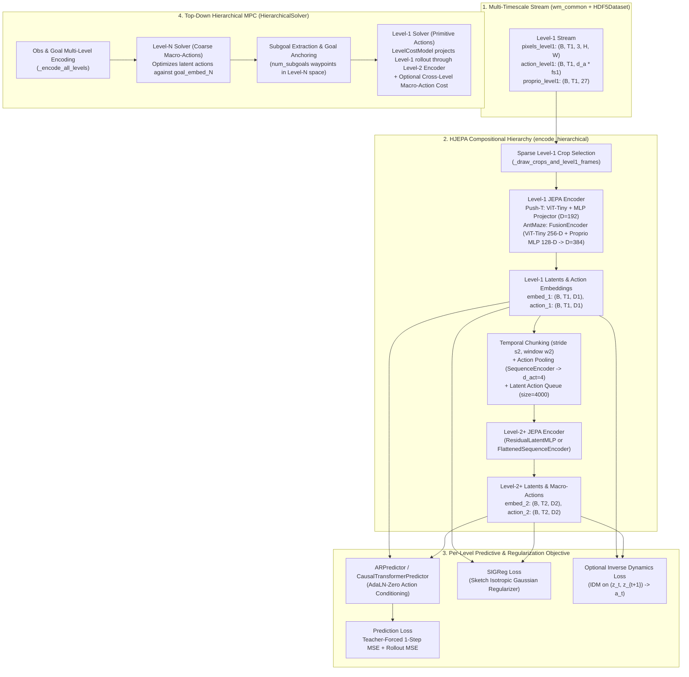

# Phased Implementation Plan: H-JEPA (`hjepa_wm`)

## 1. Goal & Scope

Port and integrate **H-JEPA** (Hierarchical Joint-Embedding Predictive Architecture, including 1-level flat **LeWM** and multi-level **H-JEPA / HWM** with $L \in \{2, 3, 4\}$) from [scratch/H-JEPA](file:///home/hanifan/wm/diffusion-wm/scratch/H-JEPA) as a standalone top-level package **`hjepa_wm/`** in `/home/hanifan/wm/diffusion-wm`.

The implementation runs natively on our existing **PyTorch Lightning + Hydra + `stable_worldmodel`** stack (eliminating the external `stable_pretraining` and SLURM-specific dependencies used in `scratch/H-JEPA`), while sharing common dataset, checkpoint, and evaluation utilities via **`wm_common/`** so `diffusion_wm/`, `hjepa_wm/`, and `hjepa_tempo_wm/` share identical benchmarks (`HDF5Dataset`, `normalizer.pt`, `eval_trajs/`), and solvers (`GradientSolver`, `CEMSolver`, and `HierarchicalSolver`) on **Push-T** (`swm/PushT-v1`) and **Visual AntMaze** (`swm/OGBAntMaze-v0`).

> [!IMPORTANT]
> **Standalone & Independent Package (`hjepa_wm/`)**:
> `hjepa_wm/` is completely independent of both `diffusion_wm/` and `hjepa_tempo_wm/` ([hjepa_tempo_plan.md](./hjepa_tempo_plan.md)). Later TEMPO integration in `hjepa_tempo_wm/` wraps frozen `hjepa_wm` checkpoints externally without modifying any `hjepa_wm` model, trainer, or solver code.

---

## 2. Package Layout & System Architecture Overview

```text
/home/hanifan/wm/diffusion-wm/
├── stable_worldmodel/          # World, HDF5Dataset, PlanConfig, HierarchicalPlanConfig, Solvers
├── wm_common/                  # Shared infra extracted from diffusion_wm/ (no model specifics)
│   ├── data.py                 # HDF5Dataset builder (with multi-level span), normalizer.pt
│   ├── utils.py                # Checkpoint resolver, ModelObjectCallback (+ state_dict + cfg), PlanningEvalCallback
│   ├── planning_eval.py        # Shared closed-loop evaluation runner & metrics writer
│   └── assets/eval_trajs/      # Fixed Push-T & Visual AntMaze evaluation tasks
├── diffusion_wm/               # Existing Diffusion World Model (thin compatibility shims to wm_common)
├── hjepa_wm/                   # Independent H-JEPA / LeWM package
│   ├── models/                 # encoders/, predictors.py, module.py, loss.py, jepa.py, hjepa.py, factory.py
│   ├── config/{train,eval}/    # Push-T & Visual AntMaze LeWM / H-JEPA Hydra configs
│   ├── train.py                # HJEPALightningModule + Hydra entry point
│   ├── eval.py                 # Standalone planning eval CLI
│   └── probing.py              # Post-hoc CLSDecoder & state probe evaluation
└── hjepa_tempo_wm/             # Independent TEMPO package (see hjepa_tempo_plan.md)
```



### Reference Mapping (`scratch/H-JEPA` $\rightarrow$ `hjepa_wm` / `wm_common`)

| Reference File in `scratch/H-JEPA` | Target Location | Role & Adaptation Notes |
| :--- | :--- | :--- |
| [module.py](file:///home/hanifan/wm/diffusion-wm/scratch/H-JEPA/h_jepa/models/module.py) | `hjepa_wm/models/module.py` | Core building blocks: `MLP`, `ResidualLatentMLP`, `Embedder`, `Attention`, `ConditionalBlock`, `Transformer`, `CLSDecoder`, `build_projector`. |
| [hf_vit.py](file:///home/hanifan/wm/diffusion-wm/scratch/H-JEPA/h_jepa/models/encoders/hf_vit.py), [encoders.py](file:///home/hanifan/wm/diffusion-wm/scratch/H-JEPA/h_jepa/models/encoders/encoders.py), [seq_encoder.py](file:///home/hanifan/wm/diffusion-wm/scratch/H-JEPA/h_jepa/models/encoders/seq_encoder.py), [build_encoder.py](file:///home/hanifan/wm/diffusion-wm/scratch/H-JEPA/h_jepa/models/encoders/build_encoder.py) | `hjepa_wm/models/encoders/` | ViT (`tiny`/`small`/`base`), `MLP` proprio encoder, `ResidualLatentMLP` upper-level state encoder, `SequenceEncoder` / `SequenceMLPEncoder` macro-action compressors. |
| [predictors.py](file:///home/hanifan/wm/diffusion-wm/scratch/H-JEPA/h_jepa/models/predictors/predictors.py) | `hjepa_wm/models/predictors.py` | `ARPredictor` and `CausalTransformerPredictor` with AdaLN-Zero conditioning. |
| [loss.py](file:///home/hanifan/wm/diffusion-wm/scratch/H-JEPA/h_jepa/loss.py) | `hjepa_wm/models/loss.py` | `SIGReg` (empirical characteristic function Gaussian sketch regularizer), `InverseDynamicsModel`, `InverseDynamicsLoss`. |
| [jepa.py](file:///home/hanifan/wm/diffusion-wm/scratch/H-JEPA/h_jepa/models/jepa.py) | `hjepa_wm/models/jepa.py` | Single-level `JEPA` (`ProjectedEncoder`, `FusionEncoder`, `ProjectedPredictor`, temporal chunking, `latent_action_queue`, `encode`, `rollout`, `criterion`, `get_cost`). |
| [hjepa.py](file:///home/hanifan/wm/diffusion-wm/scratch/H-JEPA/h_jepa/models/hjepa.py) | `hjepa_wm/models/hjepa.py` | Multi-level `HJEPA` container (`encode_hierarchical` with `sparse_level1_encode`, random level cropping, plus flat `Costable` delegation when $L=1$). |
| [hjepa_utils.py](file:///home/hanifan/wm/diffusion-wm/scratch/H-JEPA/h_jepa/hjepa_utils.py) | `hjepa_wm/models/factory.py` | `create_hjepa_world_model(cfg)` and `compute_hjepa_loss(model, sigreg_modules, batch, cfg)` running in pure PyTorch Lightning without `stable_pretraining`. |
| [hierarchical_solver.py](file:///home/hanifan/wm/diffusion-wm/scratch/H-JEPA/h_jepa/hierarchical_solver.py) | `stable_worldmodel/solver/hierarchical.py` | `HierarchicalSolver`, `LevelCostModel`, and `build_hierarchical_solver` supporting both `GradientSolver` and `CEMSolver` per level. |
| [main_hjepa.py](file:///home/hanifan/wm/diffusion-wm/scratch/H-JEPA/h_jepa/main_hjepa.py) | `hjepa_wm/train.py` | Native PyTorch Lightning training entry point (`HJEPALightningModule`) with per-level LR parameter groups and per-level gradient clipping. |
| [probers.py](file:///home/hanifan/wm/diffusion-wm/scratch/H-JEPA/h_jepa/models/probers.py), [main_probing_decoding_eval.py](file:///home/hanifan/wm/diffusion-wm/scratch/H-JEPA/h_jepa/main_probing_decoding_eval.py) | `hjepa_wm/probing.py` | Post-hoc `CLSDecoder` training & state probing so latent H-JEPA rollouts/subgoals can be decoded to RGB images for visual comparison against `DiffusionWorldModel`. |

---

## 3. Phased Implementation Plan

### Phase 0: Shared Infrastructure Extraction (`wm_common/`) & Packaging

**Objective**: Factor non-diffusion data/evaluation/checkpoint boilerplate out of `diffusion_wm/` into `wm_common/` so `diffusion_wm/`, `hjepa_wm/`, and `hjepa_tempo_wm/` stay DRY without breaking existing `diffusion_wm` workflows.

1. **Extract `wm_common/`**:
   - Move generic `HDF5Dataset` building (`build_hdf5_dataset`, `build_normalizer_artifact`, `get_column_normalizer`, `normalize_uint8_images_on_device`), checkpoint resolution + callbacks (`resolve_model_checkpoint_path`, `ModelObjectCallback`, `PlanningEvalCallback`), and closed-loop planning evaluation (`run_planning_eval`) from [diffusion_wm/data.py](file:///home/hanifan/wm/diffusion-wm/diffusion_wm/data.py), [diffusion_wm/utils.py](file:///home/hanifan/wm/diffusion-wm/diffusion_wm/utils.py), and [diffusion_wm/planning_eval.py](file:///home/hanifan/wm/diffusion-wm/diffusion_wm/planning_eval.py) into `wm_common/`.
   - Keep thin re-export shims in `diffusion_wm/{data,utils,planning_eval}.py` so existing `diffusion_wm` CLI commands, notebooks, and `pytest` tests continue passing unchanged.
2. **Extend `wm_common/data.py` for Multi-Level H-JEPA Spans**:
   - Port `_compute_level1_steps_for_hierarchy` from [scratch/H-JEPA/h_jepa/data.py](file:///home/hanifan/wm/diffusion-wm/scratch/H-JEPA/h_jepa/data.py) into `wm_common/data.py` so `build_hdf5_dataset` computes the required Level-1 sequence length when `level2`, `level3`, or `level4` are configured.
3. **Resilient Checkpoint Saving (`wm_common/utils.py`)**:
   - Update `ModelObjectCallback` so that in addition to `*_object.ckpt` (needed for `swm.policy.AutoCostModel`), it saves a portable `*_weights.pt` (`{"state_dict": model.state_dict(), "model_cfg": OmegaConf.to_container(cfg, resolve=True)}`). This prevents fragile whole-object pickle breakage if module paths ever refactor, and lets `hjepa_tempo_wm/` load `hjepa_wm` cleanly either way.
4. **Update [pyproject.toml](file:///home/hanifan/wm/diffusion-wm/pyproject.toml)**:
   - Register `packages = ["stable_worldmodel", "wm_common", "diffusion_wm", "hjepa_wm", "hjepa_tempo_wm"]` and add `"wm_common"`, `"hjepa_wm"`, `"hjepa_tempo_wm"` to `[tool.pytest.ini_options]`.

**Deliverables**:
- `wm_common/{__init__.py,data.py,utils.py,planning_eval.py}`
- Updated `pyproject.toml` and thin re-export shims in `diffusion_wm/`.

---

### Phase 1: Core Neural Modules, Encoders, Predictors & Regularizers (`hjepa_wm/models/`)

**Objective**: Port the self-contained neural network building blocks and anti-collapse regularizers from `scratch/H-JEPA` into `hjepa_wm/models/`.

1. **Transformer & Projector Primitives (`hjepa_wm/models/module.py`)**:
   - Port `build_projector` (`mlp` with `BatchNorm1d` and hidden dim `2048`, `layernorm`, `identity`), `Attention` (causal SDPA), `ConditionalBlock` (AdaLN-Zero), `Transformer`, `Embedder` (optional `1x1` Conv1d `patch_embed` + 2-layer SiLU MLP), `MLP`, `ResidualLatentMLP`, and `CLSDecoder` from [module.py](file:///home/hanifan/wm/diffusion-wm/scratch/H-JEPA/h_jepa/models/module.py).
2. **Observation, Proprio & Sequence Encoders (`hjepa_wm/models/encoders/`)**:
   - Port `create_hf_vit` (`tiny`/`small`/`base`) from [hf_vit.py](file:///home/hanifan/wm/diffusion-wm/scratch/H-JEPA/h_jepa/models/encoders/hf_vit.py) supporting `224×224` (`patch_size=14`, Push-T) and `64×64` (`patch_size=4`, Visual AntMaze).
   - Port `SequenceEncoder`, `FlattenedSequenceEncoder`, and `SequenceMLPEncoder` from [seq_encoder.py](file:///home/hanifan/wm/diffusion-wm/scratch/H-JEPA/h_jepa/models/encoders/seq_encoder.py) for compressing lower-level action/state chunks into macro-actions (`output_dim=4` on Push-T, `output_dim=16` on AntMaze) or upper-level state embeddings.
   - Port `build_encoder` from [build_encoder.py](file:///home/hanifan/wm/diffusion-wm/scratch/H-JEPA/h_jepa/models/encoders/build_encoder.py).
3. **Latent Dynamics Predictors (`hjepa_wm/models/predictors.py`)**:
   - Port `ARPredictor` and `CausalTransformerPredictor` from [predictors.py](file:///home/hanifan/wm/diffusion-wm/scratch/H-JEPA/h_jepa/models/predictors/predictors.py).
4. **Anti-Collapse & Auxiliary Losses (`hjepa_wm/models/loss.py`)**:
   - Port `SIGReg` (ECF Gaussian sketch regularizer over `knots=17`, `num_proj=1024`), `InverseDynamicsModel`, and `InverseDynamicsLoss` from [loss.py](file:///home/hanifan/wm/diffusion-wm/scratch/H-JEPA/h_jepa/loss.py).

**Deliverables**:
- `hjepa_wm/models/module.py`
- `hjepa_wm/models/encoders/{__init__.py,hf_vit.py,encoders.py,seq_encoder.py,build_encoder.py}`
- `hjepa_wm/models/predictors.py`
- `hjepa_wm/models/loss.py`

---

### Phase 2: `JEPA`, `HJEPA` Containers & Model Factory

**Objective**: Implement single-level `JEPA` and multi-level `HJEPA`, adhering to the `stable_worldmodel` `Costable` interface while supporting sparse hierarchical encoding and loss computation.

1. **Single-Level `JEPA` (`hjepa_wm/models/jepa.py`)**:
   - Port `ProjectedEncoder`, `FusionEncoder` (`pixels` $\to$ `pixel_embed` + `proprio` $\to$ `proprio_embed` $\to$ `embed`), and `ProjectedPredictor` from [jepa.py](file:///home/hanifan/wm/diffusion-wm/scratch/H-JEPA/h_jepa/models/jepa.py).
   - Port temporal chunking (`_state_windows`, `_action_windows`, `_chunk_temporal_info`), `latent_action_queue` ring buffer (including custom `_load_from_state_dict`), `encode`, `predict`, `parallel_unroll`, `rollout`, `criterion`, and `get_cost`.
2. **Multi-Level `HJEPA` (`hjepa_wm/models/hjepa.py`)**:
   - Port `HJEPA(nn.Module)` with **Sparse Level-1 Encoding** (`sparse_level1_encode=True`): `_draw_crops_and_level1_frames` draws each level's crop start before encoding so the Level-1 ViT only processes frames actually referenced by kept windows across levels.
   - Add `Costable` delegation methods (`encode`, `rollout`, `criterion`, `get_cost`, `get_latent_action_queue`) forwarding to `self.get_level(1)` when `HJEPA` is evaluated with a flat 1-level solver.
3. **Model Factory & Loss Computation (`hjepa_wm/models/factory.py`)**:
   - Adapt `create_world_model(cfg)` and `hjepa_forward(...)` from [hjepa_utils.py](file:///home/hanifan/wm/diffusion-wm/scratch/H-JEPA/h_jepa/hjepa_utils.py):
     - Build `HJEPA` and register all `SIGReg` modules inside an `nn.ModuleDict` owned by `HJEPALightningModule`.
     - Implement `compute_hjepa_loss(model, sigreg_modules, batch, cfg)` returning total `loss` and per-level diagnostics (`pred_loss_level{l}`, `teacher_forcing_loss_level{l}`, `rollout_loss_level{l}`, `sigreg_loss_level{l}`, `idm_loss_level{l}`, `mse_loss_level{l}`).

**Deliverables**:
- `hjepa_wm/models/{__init__.py,jepa.py,hjepa.py,factory.py}`

---

### Phase 3: Top-Down Hierarchical Planner & Solver Integration

**Objective**: Port `HierarchicalSolver` and `LevelCostModel`, reuse `stable_worldmodel`'s existing `PlanConfig` / `HierarchicalPlanConfig`, and verify compatibility with both `GradientSolver` and `CEMSolver`.

1. **Hierarchical Solver (`stable_worldmodel/solver/hierarchical.py`)**:
   - Port `HierarchicalSolver`, `LevelCostModel`, and `build_hierarchical_solver` from [hierarchical_solver.py](file:///home/hanifan/wm/diffusion-wm/scratch/H-JEPA/h_jepa/hierarchical_solver.py):
     - `_encode_all_levels`: Bottom-up encoding of observations and goals across Levels $1 \dots L$.
     - `solve`: Top-down loop ($\ell = L \dots 1$) with recursive `_horizon_schedules`, upper horizon-1 skipping (`horizon_one_goal_cost_space`), subgoal extraction (`num_subgoals`), and **goal anchoring**.
     - `LevelCostModel`: Rolls out candidate actions at `self.level`, projects states (`_encode_states_up`) and actions (`_encode_actions_up`) to `goal_level` when `goal_embed_0_in_upper_space=True`, and computes `JEPA.criterion` + `action_cost_weight * _action_cost`.
2. **Solver Compatibility Check (`GradientSolver` & `CEMSolver`)**:
   - Reuse [stable_worldmodel/solver/gd.py](file:///home/hanifan/wm/diffusion-wm/stable_worldmodel/solver/gd.py) and update [stable_worldmodel/solver/cem.py](file:///home/hanifan/wm/diffusion-wm/stable_worldmodel/solver/cem.py) so `CEMSolver.configure(..., level=level)` matches `GradientSolver.configure` and initializes `level > 1` candidate macro-actions from `model.get_latent_action_queue()` when available.
3. **Evaluation Pipeline Integration (`wm_common/planning_eval.py`)**:
   - Reuse the existing `PlanConfig` and `HierarchicalPlanConfig` dataclasses already defined in [stable_worldmodel/policy.py](file:///home/hanifan/wm/diffusion-wm/stable_worldmodel/policy.py#L16-L62).
   - Update `_build_policy` and `build_solver` in `wm_common/planning_eval.py` to build `HierarchicalPlanConfig` when `cfg.get('hierarchical_plan_config')` is present and route `HierarchicalSolver` instantiation through `build_hierarchical_solver(cfg, model)`.

**Deliverables**:
- `stable_worldmodel/solver/hierarchical.py` (exported in `stable_worldmodel/solver/__init__.py`)
- Updated `stable_worldmodel/solver/cem.py`
- Updated `wm_common/planning_eval.py` supporting flat `plan_config` and `hierarchical_plan_config`.

---

### Phase 4: Training Pipeline, Hydra Configs & Visual Decoding (`hjepa_wm/`)

**Objective**: Provide clean standalone CLI entry points and Hydra configurations for training, evaluating, and decoding 1-level LeWM and multi-level H-JEPA models.

1. **PyTorch Lightning Training Entry Point (`hjepa_wm/train.py`)**:
   - Implement `HJEPALightningModule(pl.LightningModule)`:
     - Owns `model: HJEPA` and `sigreg_modules: nn.ModuleDict`.
     - `training_step` / `validation_step`: normalizes uint8 images on device via `wm_common.data.normalize_uint8_images_on_device` and computes `compute_hjepa_loss`.
     - `configure_optimizers`: per-level `AdamW` parameter groups (`level1` `lr=5e-5`, `level2+` `lr=1e-5`) with linear warmup + cosine annealing.
     - `clip_gradients`: supports `grad_clip_per_level: true` (per-level gradient norm budget `gradient_clip_val=1.0`).
   - Uses `wm_common.data.build_hdf5_dataset`, `save_normalizer_artifact`, `ModelObjectCallback`, and `PlanningEvalCallback`.
2. **Standalone Evaluation Entry Point (`hjepa_wm/eval.py`)**:
   - Hydra CLI wrapping `wm_common.planning_eval.run_planning_eval` pointing to `hjepa_wm/config/eval/`.
3. **Hydra Configurations (`hjepa_wm/config/`)**:
   - **Train (`hjepa_wm/config/train/`)**: `base/pusht.yaml`, `base/ant.yaml`, `pusht_lewm.yaml`, `pusht_hjepa_l2.yaml`, `pusht_hjepa_l3.yaml`, `ant_lewm.yaml`, `ant_hjepa_l2.yaml`, `ant_hjepa_l3.yaml`.
   - **Eval (`hjepa_wm/config/eval/`)**: `pusht_lewm_gd.yaml`, `pusht_lewm_cem.yaml`, `pusht_hjepa_l2.yaml`, `pusht_hjepa_l2_project.yaml`, `pusht_hjepa_l3.yaml`, `ant_lewm_gd.yaml`, `ant_lewm_cem.yaml`, `ant_hjepa_l2.yaml`, `ant_hjepa_l2_project.yaml`, `ant_hjepa_l3.yaml`.
4. **Post-Hoc Visual Decoder & State Probing (`hjepa_wm/probing.py`)**:
   - Port `CLSDecoder` training and `train_probes` from [main_probing_decoding_eval.py](file:///home/hanifan/wm/diffusion-wm/scratch/H-JEPA/h_jepa/main_probing_decoding_eval.py) to decode H-JEPA rollouts and planned subgoals to RGB images for qualitative comparison against `DiffusionWorldModel`'s native SD-VAE dreams.

**Deliverables**:
- `hjepa_wm/{__init__.py,train.py,eval.py,probing.py}`
- `hjepa_wm/config/train/*.yaml` and `hjepa_wm/config/eval/*.yaml`.

---

### Phase 5: Verification, Testing & Benchmark Comparison

**Objective**: Validate numerical equivalence with `scratch/H-JEPA`, verify cross-level gradient flow and `CEMSolver` / `GradientSolver` behavior, and benchmark against `DiffusionWorldModel`.

1. **Automated Unit & Integration Tests (`tests/test_hjepa.py`)**:
   - **Sparse vs. Dense Level-1 Encoding**: Verify `HJEPA.encode_hierarchical(info, sparse_level1_encode=True)` matches `sparse_level1_encode=False` identically for fixed crop starts.
   - **Architecture & Loss Test**: Verify 2-level Push-T (`use_proprio=False`, `D=192`) and Visual AntMaze (`use_proprio=True`, `D=384`) `HJEPA` models compute non-NaN losses and propagate gradients to all levels.
   - **Cross-Level Solver Test**: Run `HierarchicalSolver.solve()` with both `GradientSolver` and `CEMSolver` on a 2-level `HJEPA`, verifying Level-2 macro-action optimization, subgoal passing, and Level-1 gradient propagation through `LevelCostModel`.
   - **End-to-End Smoke Test**: 1-epoch `hjepa_wm/train.py` run on synthetic HDF5 data $\rightarrow$ save `*_object.ckpt` + `*_weights.pt` + `normalizer.pt` $\rightarrow$ load and run short closed-loop evaluation in `swm/PushT-v1` and `swm/OGBAntMaze-v0`.
2. **Verification Commands**:
   ```bash
   # Unit and smoke tests
   uv run pytest tests/test_hjepa.py -v

   # Train 1-level LeWM and 2-level H-JEPA on Push-T
   uv run python -m hjepa_wm.train --config-name pusht_lewm seed=42
   uv run python -m hjepa_wm.train --config-name pusht_hjepa_l2 seed=42

   # Evaluate flat and hierarchical planning
   uv run python -m hjepa_wm.eval --config-name pusht_lewm_gd \
       policy="$HJEPA_HOME/ckpts/pusht/pusht_lewm/seed42/pusht_lewm_object.ckpt"
   uv run python -m hjepa_wm.eval --config-name pusht_hjepa_l2 \
       policy="$HJEPA_HOME/ckpts/pusht/pusht_hjepa_l2/seed42/pusht_hjepa_l2_object.ckpt"
   ```
