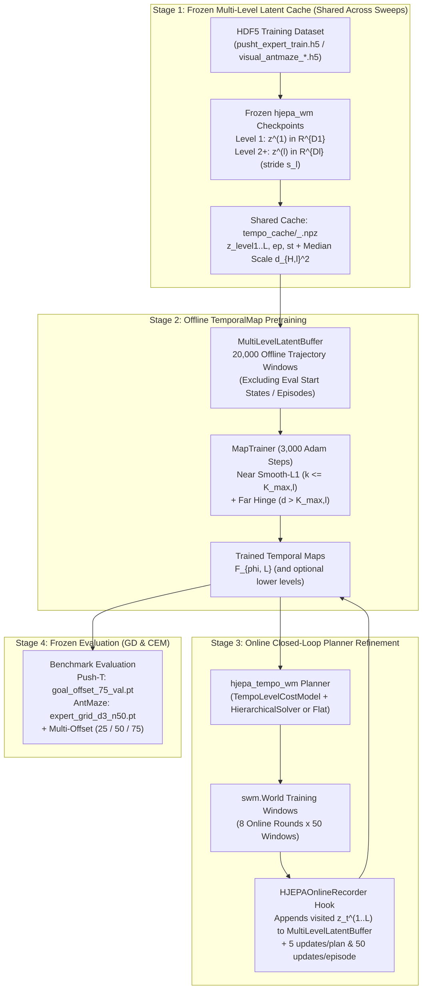
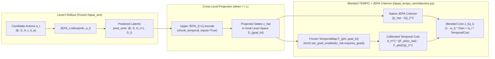

# Phased Implementation Plan: H-JEPA with TEMPO (`hjepa_tempo_wm`)

## 1. Goal & Motivation

Implement **H-JEPA + TEMPO** as a standalone top-level package **`hjepa_tempo_wm/`** in `/home/hanifan/wm/diffusion-wm` by combining frozen 1-level **LeWM** and multi-level **H-JEPA** world models from `hjepa_wm/` ([hjepa_plan.md](./hjepa_plan.md), adapted from [scratch/H-JEPA](file:///home/hanifan/wm/diffusion-wm/scratch/H-JEPA)) with **TEMPO** (**TEM**poral **P**lanning **O**bjective from [scratch/tempo](file:///home/hanifan/wm/diffusion-wm/scratch/tempo)) for long-horizon visual planning on **Push-T** (`swm/PushT-v1`) and **Visual AntMaze** (`swm/OGBAntMaze-v0`).

> [!IMPORTANT]
> **Strict Independence Guarantee (Zero Modifications to `hjepa_wm/` or `stable_worldmodel/`)**:
> `hjepa_wm/` (`models/`, `train.py`, `eval.py`, `config/`) and `stable_worldmodel/solver/hierarchical.py` remain **100% untouched** with zero TEMPO imports, flags, or hooks.
> All TEMPO code lives exclusively in **`hjepa_tempo_wm/`** and wraps frozen `hjepa_wm` checkpoints externally via composition (`TempoCostModel`, `TempoLevelCostModel`, and `build_tempo_hierarchical_solver`).

### Why Combine H-JEPA and TEMPO?

1. **Overcoming Myopic Latent Distance at Long Horizons**:
   - Standard JEPA / H-JEPA planners minimize Euclidean distance $\|\hat{z}_{t+H} - z_g\|_2^2$ in an embedding space shaped by prediction loss and `SIGReg`. Across obstacles or contact bottlenecks, Euclidean distance misleads the planner:
     - In **Visual AntMaze**, an Ant separated from the goal by a thin maze wall has small Euclidean latent distance despite being $>150$ environment steps away around a U-turn.
     - In **Push-T**, a pusher on the wrong side of the T-block can have small latent distance to the goal while needing a multi-step disengagement maneuver.
2. **Synergy of Compositional Hierarchy + Temporal Distance Map**:
   - **H-JEPA** supplies multi-timescale rollouts and top-down subgoal decomposition (`HierarchicalSolver`).
   - **TEMPO** learns a label-free temporal map $F_{\phi, \ell}: \mathbb{R}^{D_\ell} \to \mathbb{R}^{64}$ where Euclidean distance counts *trajectory steps-to-go* ($\|F_{\phi, \ell}(z_t^{(\ell)}) - F_{\phi, \ell}(z_{t+k}^{(\ell)})\|_2 \approx k / \kappa_\ell$).
   - **Top-Level Focus ($w_L > 0, w_1 = 0$)**: In hierarchical planning, Level 1 only plans short local horizons ($H_1 = 2$, ~10 env steps) toward an adjacent Level-2 waypoint where Euclidean latent MSE is already locally accurate. Non-convex wall/contact traps happen at **long horizons** (Level $L$, or flat 1-level LeWM), so applying TEMPO primarily at the top level ($w_L > 0$, $w_1 = 0$ by default, with lower-level weights optional) halves compute and preserves crisp local subgoal tracking.

---

## 2. Package Layout & Pipeline Overview

```text
/home/hanifan/wm/diffusion-wm/
├── stable_worldmodel/          # Unchanged: World, HDF5Dataset, GradientSolver, CEMSolver, HierarchicalSolver
├── wm_common/                  # Shared data, checkpoint loader, and planning_eval utilities
├── hjepa_wm/                   # Unchanged: original LeWM / H-JEPA models, checkpoints, and baselines
└── hjepa_tempo_wm/             # Independent H-JEPA + TEMPO package
    ├── temporal_map.py         # TemporalMap F_phi and temporal_distance_loss
    ├── buffer.py               # LatentBuffer & MultiLevelLatentBuffer
    ├── trainer.py              # MapTrainer & MultiLevelMapTrainer
    ├── config.py               # MapConfig, TempoTrainConfig, LevelTempoConfig
    ├── data.py                 # HDF5 multi-level frozen latent encoding & shared cache
    ├── objective.py            # TemporalDistanceCost, TempoCostModel, TempoLevelCostModel, build_tempo_hierarchical_solver
    ├── online.py               # HJEPAOnlineRecorder (closed-loop multi-level latent recording)
    ├── pipeline.py             # 4-stage pipeline: encode -> offline -> online -> eval
    ├── eval.py                 # Hydra CLI entry point
    ├── visualize.py            # Calibration curves & 2D maze/block temporal distance heatmaps
    └── config/                 # Hydra YAML configs (pusht_lewm_tempo, pusht_hjepa_l2_tempo, ant_*)
```



### Mathematical Formulation & Timescale Calibration

For each hierarchy level $\ell \in \{1, \dots, L\}$ in a frozen `HJEPA` checkpoint:

1. **Effective Timescale**:
   - Level 1 spans $\Delta_1 = \text{frameskip}_1$ environment steps per latent frame (e.g., $\Delta_1 = 5$).
   - Level $\ell > 1$ chunks Level $\ell - 1$ with stride $s_\ell$, so one latent step at level $\ell$ spans:
     $$\Delta_\ell = \Delta_1 \prod_{j=2}^{\ell} s_j \quad \text{environment steps}$$
   - Config specifies horizons in **environment steps** (`kappa_env_steps=25.0`, `max_env_steps=75.0`), which `config.py` converts automatically to level-$\ell$ latent steps: $\kappa_\ell = \kappa_{\text{env}} / \Delta_\ell$ and $K_{\max, \ell} = \max(2, \lfloor K_{\max, \text{env}} / \Delta_\ell \rfloor)$.
2. **Per-Level Temporal Map $F_{\phi, \ell}: \mathbb{R}^{D_\ell} \to \mathbb{R}^{d_{\text{map}}}$**:
   $$\mathcal{L}_{\text{TEMPO}}^{(\ell)}(\phi_\ell) = \mathbb{E}_{k \le K_{\max, \ell}}\!\left[\text{SmoothL1}\!\left(\|F_{\phi, \ell}(z_t^{(\ell)}) - F_{\phi, \ell}(z_{t+k}^{(\ell)})\|_2,\; \frac{k}{\kappa_\ell}\right)\right] + \lambda_{\text{far}}\,\mathbb{E}_{d > K_{\max, \ell}}\!\left[\max\!\left(0,\; \frac{K_{\max, \ell}}{\kappa_\ell} - \|F_{\phi, \ell}(z_t^{(\ell)}) - F_{\phi, \ell}(z_{t+d}^{(\ell)})\|_2\right)\right]$$
3. **Scale Calibration ($\bar{d}_{H_\ell}^2$) & Blended Planning Cost**:
   - Compute $\bar{d}_{H_\ell} = \text{median}_{(i, t)}\,\|z_{i, t + H_\ell}^{(\ell)} - z_{i, t}^{(\ell)}\|_2$ over same-episode pairs $H_\ell$ steps apart.
   - At level $\ell$ evaluating predictions against `goal_level`:
     $$J_\ell(a_\ell) = (1 - w_\ell)\,\mathcal{L}_{\text{JEPA}}\!\left(\hat{z}^{(\text{goal\_lvl})},\, G^{(\text{goal\_lvl})}\right) + w_\ell\,\bar{d}_{H_{\text{goal\_lvl}}}^2\,\left\|F_{\phi, \text{goal\_lvl}}\!\left(\hat{z}_{\text{term}}^{(\text{goal\_lvl})}\right) - F_{\phi, \text{goal\_lvl}}\!\left(G_{\text{term}}^{(\text{goal\_lvl})}\right)\right\|_2^2 + \lambda_{\text{act}, \ell}\,\mathcal{L}_{\text{act}}(a_\ell, A_{\ell+1})$$
   - Setting $w_\ell = 0$ recovers the exact unmodified `hjepa_wm` baseline planner.

---

## 3. Reference Mapping (`scratch/tempo` + `scratch/H-JEPA` $\rightarrow$ `hjepa_tempo_wm`)

| Reference File in `scratch/` | Target Location in `hjepa_tempo_wm/` | Role & Adaptation Notes |
| :--- | :--- | :--- |
| [temporal_map.py](file:///home/hanifan/wm/diffusion-wm/scratch/tempo/src/tempo/temporal_map.py) | `hjepa_tempo_wm/temporal_map.py` | `TemporalMap` (`SiLU` MLP: $D_\ell \to 256 \to 256 \to 64$, optional spectral norm) and `temporal_distance_loss`. |
| [buffer.py](file:///home/hanifan/wm/diffusion-wm/scratch/tempo/src/tempo/buffer.py) | `hjepa_tempo_wm/buffer.py` | `LatentBuffer` and `MultiLevelLatentBuffer` for storing per-level episode trajectories and sampling `near`/`far` pairs. |
| [trainer.py](file:///home/hanifan/wm/diffusion-wm/scratch/tempo/src/tempo/trainer.py) | `hjepa_tempo_wm/trainer.py` | `MapTrainer` and `MultiLevelMapTrainer` managing Adam updates, gradient clipping (`10.0`), and `fmap_hjepa.pt` checkpointing. |
| [config.py](file:///home/hanifan/wm/diffusion-wm/scratch/tempo/src/tempo/config.py) | `hjepa_tempo_wm/config.py` | `MapConfig`, `TempoTrainConfig`, and `LevelTempoConfig` converting env-step horizons into per-level $\kappa_\ell$ and $K_{\max, \ell}$. |
| [tempo/data.py](file:///home/hanifan/wm/diffusion-wm/scratch/tempo/src/tempo/data.py) | `hjepa_tempo_wm/data.py` | Reads `HDF5Dataset` + `normalizer.pt` (via `wm_common`) and caches frozen multi-level latents keyed by `(checkpoint_hash, dataset_name)`. |
| [objective.py](file:///home/hanifan/wm/diffusion-wm/scratch/tempo/src/tempo/objective.py) | `hjepa_tempo_wm/objective.py` | `TemporalDistanceCost`, `TempoCostModel`, `TempoLevelCostModel` (external subclass of `LevelCostModel`), and `build_tempo_hierarchical_solver`. |
| [online.py](file:///home/hanifan/wm/diffusion-wm/scratch/tempo/src/tempo/online.py) + [planner.py](file:///home/hanifan/wm/diffusion-wm/scratch/tempo/src/tempo/planner.py) | `hjepa_tempo_wm/online.py` | `HJEPAOnlineRecorder` hooking `world.envs.step` / `reset` to record multi-level online rollouts and refine $F_{\phi, \ell}$. |
| [pipeline.py](file:///home/hanifan/wm/diffusion-wm/scratch/tempo/src/tempo/pipeline.py) | `hjepa_tempo_wm/pipeline.py` & `hjepa_tempo_wm/eval.py` | 4-stage runner (`encode` $\rightarrow$ `offline` $\rightarrow$ `online` $\rightarrow$ `eval`) + Hydra CLI supporting fixed `.pt` benchmarks and multi-offset evaluation. |

---

## 4. Phased Implementation Plan

### Phase 1: Core TEMPO Primitives & Multi-Level Buffer (`hjepa_tempo_wm/`)

**Objective**: Port `TemporalMap`, `temporal_distance_loss`, `LatentBuffer`, and `MapTrainer` from `scratch/tempo`, adding multi-level support and smooth differentiability.

1. **Temporal Map & Loss (`hjepa_tempo_wm/temporal_map.py`)**:
   - Port `mlp`, `TemporalMap(latent_dim, out_dim=64, hidden=256, layers=2, kappa=25.0, spectral_norm=False)`, and `temporal_distance_loss` from [temporal_map.py](file:///home/hanifan/wm/diffusion-wm/scratch/tempo/src/tempo/temporal_map.py).
   - Ensure `TemporalMap.sqdist(za, zb)` supports arbitrary leading axes `(B, S, W, D)` and uses squared Euclidean distance (smooth everywhere, avoiding the $\nabla \|\cdot\|_2$ singularity at $0$ when differentiating).
   - Optional `spectral_norm=True` flag on `TemporalMap` linear layers as a safeguard against off-manifold gradient exploitation when planning with `GradientSolver`.
2. **Single- & Multi-Level Latent Buffers (`hjepa_tempo_wm/buffer.py`)**:
   - Port `LatentBuffer` and implement `MultiLevelLatentBuffer(latent_dims, strides, window_sizes)`:
     - Holds one `LatentBuffer` per level $\ell = 1 \dots L$.
     - During online episodes (`start`/`append`/`close`), maintains per-env Level-1 latent history and emits upper-level latents $z_T^{(\ell)}$ every $s_\ell$ steps via the frozen `hjepa_wm` level-$\ell$ encoder.
3. **Map Trainer (`hjepa_tempo_wm/trainer.py`) & Config (`hjepa_tempo_wm/config.py`)**:
   - Port `MapTrainer` and add `MultiLevelMapTrainer` saving/loading `{level: trainer.state_dict(), scales: {level: scale}, meta: {...}}` to `fmap_hjepa.pt`.
   - Implement `LevelTempoConfig` with automatic $\Delta_\ell$-aware conversion from `kappa_env_steps` / `max_env_steps` to per-level latent step units.

**Deliverables**:
- `hjepa_tempo_wm/{__init__.py,temporal_map.py,buffer.py,trainer.py,config.py}`

---

### Phase 2: Shared HDF5 Multi-Level Latent Cache & Scale Calibration

**Objective**: Encode frozen `hjepa_wm` latents from `HDF5Dataset` into a shared cache keyed by `(checkpoint_hash, dataset_name)` so hyperparameter sweeps (`w`, `GradientSolver` vs. `CEMSolver`, `goal_offset`) never re-encode the dataset.

1. **HDF5 Episode Table & Shared Cache (`hjepa_tempo_wm/data.py`)**:
   - Implement `episode_table_from_hdf5(dataset: swm.data.HDF5Dataset) -> EpisodeTable` using `episode_idx`/`ep_idx` and `step_idx`.
   - Compute deterministic cache key `<ckpt_sha256_12>_<dataset_name>.npz` stored under `$HJEPA_HOME/tempo_cache/` (independent of any specific `w` or solver run directory).
2. **Frozen Multi-Level Dataset Encoder (`encode_hjepa_dataset`)**:
   - Loads frozen `HJEPA` checkpoint (`AutoCostModel` or `*_weights.pt`) + `normalizer.pt` via `wm_common.utils` and `wm_common.data`.
   - Encodes training episodes bottom-up through Levels $\ell = 1 \dots L$ (`z_level1..L`, `ep_level1..L`, `st_level1..L`).
   - Computes per-level median $H_\ell$-step latent displacement `d_H_level{l}` and `scale_level{l} = d_H_level{l} ** 2`.
3. **Evaluation Leakage Guard (`exclude_eval_windows`)**:
   - Checks `assets/eval_trajs/pusht/goal_offset_75_val.pt` and `assets/eval_trajs/ant/expert_grid_d3_n50.pt` and excludes overlapping `(episode_idx, start_step)` windows from offline/online TEMPO training.

**Deliverables**:
- `hjepa_tempo_wm/data.py`

---

### Phase 3: External TEMPO Cost Wrappers for `GradientSolver` & `CEMSolver`

**Objective**: Wrap frozen `hjepa_wm` models externally in `hjepa_tempo_wm/objective.py` so both flat (`JEPA`) and hierarchical (`HierarchicalSolver`) planners work seamlessly with **both** `CEMSolver` and differentiable `GradientSolver`—without touching `hjepa_wm/` or `stable_worldmodel/`.



1. **Conditional-Autograd `TemporalDistanceCost` (`hjepa_tempo_wm/objective.py`)**:
   - Adapts [scratch/tempo/src/tempo/objective.py](file:///home/hanifan/wm/diffusion-wm/scratch/tempo/src/tempo/objective.py) to `predicted_embed_0` and `goal_embed_0`:
     - Freezes `fmap` parameters (`requires_grad_(False)`).
     - Uses `with torch.set_grad_enabled(z_T.requires_grad):` instead of unconditional `torch.no_grad()`:
       - Under `CEMSolver`: zero autograd overhead.
       - Under `GradientSolver`: smooth gradients propagate through `TemporalMap.sqdist` and `JEPA.rollout` into `action_candidates` (with native JEPA MSE weighted by $1 - w_\ell$ acting as an on-manifold trust-region anchor).
   - Also supports a **re-ranker mode** (`rerank_only=True`): optimize candidate actions using pure native JEPA cost ($w=0$) under `GradientSolver` and score/select the best sample among `num_samples` using the TEMPO blended cost—providing a safeguard ablation if GD exploits off-manifold $F_\phi$ directions.
2. **Flat Wrapper (`TempoCostModel`) & Hierarchical Wrapper (`TempoLevelCostModel`)**:
   - `TempoCostModel`: Wraps 1-level `JEPA` / `HJEPA(L=1)` implementing `Costable`.
   - `TempoLevelCostModel`: Subclasses `LevelCostModel` (imported from `stable_worldmodel.solver.hierarchical`) externally in `hjepa_tempo_wm/objective.py` to blend `(1 - w_l) * own_cost + w_l * tempo_cost` in `goal_level` latent space.
   - `build_tempo_hierarchical_solver(cfg, model, tempo_bundle)`: Instantiates `TempoLevelCostModel` per level and returns a standard `HierarchicalSolver(level_solvers=level_solvers, level_models=level_models)`.

**Deliverables**:
- `hjepa_tempo_wm/objective.py`

---

### Phase 4: 4-Stage Offline + Online Pipeline (`hjepa_tempo_wm/pipeline.py`)

**Objective**: Implement the complete `encode` $\rightarrow$ `offline` $\rightarrow$ `online` $\rightarrow$ `eval` pipeline for frozen `hjepa_wm` checkpoints.

1. **Offline Stage (`hjepa_tempo_wm/pipeline.py`)**:
   - Loads `tempo_cache/<ckpt_hash>_<dataset>.npz`.
   - Trains $F_{\phi, \ell}$ for all active TEMPO levels (by default top level $\ell = L$ only when hierarchical, or $\ell = 1$ when flat) over `offline_windows=20,000` windows for `offline_steps=3,000` Adam steps (`batch_size=256, lr=1e-3`).
   - Saves `fmap_hjepa_offline.pt` before online refinement.
2. **Online Closed-Loop Refinement Stage (`hjepa_tempo_wm/online.py`)**:
   - `HJEPAOnlineRecorder` wraps `world.envs.step` and `world.envs.reset` across `online_rounds=8` rounds of training-window rollouts (50 parallel envs/round).
   - Records real closed-loop trajectories across hierarchy levels into `MultiLevelLatentBuffer` and performs `updates_per_plan=5` and `updates_per_episode=50` updates on `MultiLevelMapTrainer`.
   - Saves final `fmap_hjepa.pt`.
3. **Evaluation Stage (`hjepa_tempo_wm/eval.py`)**:
   - Evaluates the frozen `hjepa_wm` checkpoint + `fmap_hjepa.pt` on:
     - **Fixed H-JEPA Benchmarks**: `assets/eval_trajs/pusht/goal_offset_75_val.pt` (50 tasks) and `assets/eval_trajs/ant/expert_grid_d3_n50.pt` (50 tasks).
     - **TEMPO Multi-Horizon Protocol**: `goal_offset ∈ {25, 50, 75}` steps, `w_L ∈ {0.0, 0.25, 0.5, 0.75}`, comparing **CEM**, **GradientSolver (joint)**, and **GradientSolver (re-rank)** side by side.

**Deliverables**:
- `hjepa_tempo_wm/{online.py,pipeline.py,eval.py}`

---

### Phase 5: Configs, Distance Landscape Visuals & Verification

**Objective**: Provide Hydra configs, qualitative visualizations of the temporal distance map, and rigorous unit/smoke tests.

1. **Hydra Configs (`hjepa_tempo_wm/config/`)**:
   - `pusht_lewm_tempo.yaml`: 1-level LeWM ($D_1=192$) + TEMPO ($w_1=0.5$, $\kappa_{\text{env}}=25$, $K_{\max,\text{env}}=75$) for both CEM and GD.
   - `pusht_hjepa_l2_tempo.yaml`: 2-level H-JEPA ($D_1=192, D_2=192, s_2=2, \Delta_2=10$) + Top-Level TEMPO ($w_2=0.5, w_1=0.0$).
   - `ant_lewm_tempo.yaml`: 1-level AntMaze LeWM ($D_1=384$ with 27-D proprio) + TEMPO ($w_1=0.5$).
   - `ant_hjepa_l2_tempo.yaml`: 2-level AntMaze H-JEPA ($D_1=384, D_2=384, s_2=2, \Delta_2=10$) + Top-Level TEMPO ($w_2=0.5, w_1=0.0$).
2. **Diagnostic Visualizations (`hjepa_tempo_wm/visualize.py`)**:
   - **Calibration Plot (`tempo_calibration_level{l}.png`)**: Predicted $\|F_{\phi,\ell}(z_t) - F_{\phi,\ell}(z_{t+k})\|_2$ vs. true $k/\kappa_\ell$ (raw latent distance vs. offline $F_\phi$ vs. online-refined $F_\phi$).
   - **Cost Landscape Heatmap (`tempo_landscape_comparison.png`)**: Side-by-side 2D $(x, y)$ AntMaze / Push-T plots comparing native JEPA latent distance (bleeding through maze walls) vs. TEMPO distance (contouring along navigable corridors).
3. **Automated Tests (`tests/test_hjepa_tempo.py`)**:
   - **Timescale / `frameskip` Unit Test**: Assert `delta_latent * Delta_l == delta_env_steps` and verify `kappa_l` and `max_steps_l` conversion across `frameskip=5`, `stride=2`.
   - **Loss & `sqdist` Smoothness Test**: Verify `temporal_distance_loss` decreases on synthetic trajectory latents and `sqdist(z, z)` has finite zero gradient (no `NaN` at $z_a = z_b$).
   - **$w=0$ Baseline Equivalence Test**: Verify `TempoCostModel` and `TempoLevelCostModel` with `weight=0.0` produce bit-identical costs and gradients to unmodified `hjepa_wm` (`JEPA` / `LevelCostModel`).
   - **Solver Compatibility Test (CEM, GD, Re-rank)**: Verify `GradientSolver` backpropagates through `TemporalDistanceCost` to `action_candidates` without mutating `fmap` parameters, and `CEMSolver` lowers cost across iterations.
   - **End-to-End Smoke Test**: Run `hjepa_tempo_wm/pipeline.py --smoke` (`offline_windows=64, offline_steps=5, online_rounds=1`) on a synthetic 2-level `hjepa_wm` checkpoint and HDF5 dataset.

4. **Verification Commands**:
   ```bash
   # Unit and smoke tests
   uv run pytest tests/test_hjepa_tempo.py -v

   # Run full H-JEPA + TEMPO pipeline (encode -> offline -> online -> eval)
   uv run python -m hjepa_tempo_wm.eval --config-name pusht_hjepa_l2_tempo \
       policy="$HJEPA_HOME/ckpts/pusht/pusht_hjepa_l2/seed42/pusht_hjepa_l2_object.ckpt"

   # Baseline (w=0) vs Top-Level TEMPO (w_2=0.5) on Visual AntMaze
   uv run python -m hjepa_tempo_wm.eval --config-name ant_hjepa_l2_tempo \
       policy="$HJEPA_HOME/ckpts/ant/ant_hjepa_l2/seed42/ant_hjepa_l2_object.ckpt" \
       tempo.level2.weight=0.0 tempo.level1.weight=0.0
   uv run python -m hjepa_tempo_wm.eval --config-name ant_hjepa_l2_tempo \
       policy="$HJEPA_HOME/ckpts/ant/ant_hjepa_l2/seed42/ant_hjepa_l2_object.ckpt" \
       tempo.level2.weight=0.5 tempo.level1.weight=0.0
   ```
