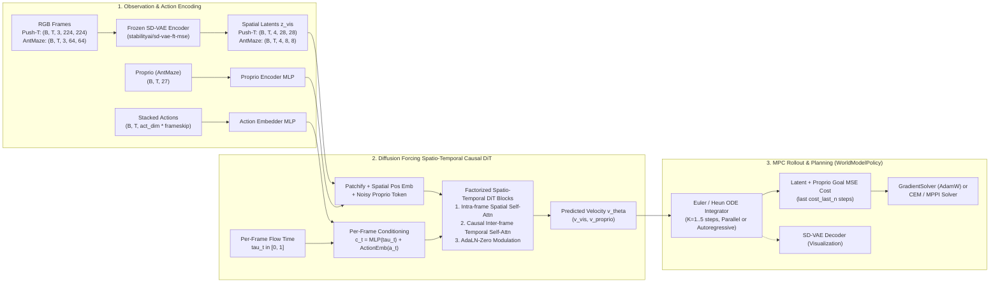

# Diffusion World Model for Push-T and Visual AntMaze

## Goal Description

Build a self-contained **Pretrained VAE Latent Diffusion World Model** in `/home/hanifan/wm/diffusion-wm` (while keeping [scratch/H-JEPA](file:///home/hanifan/wm/diffusion-wm/scratch/H-JEPA) intact as reference) to train and evaluate visual model-based planning on **Push-T** (`swm/PushT-v1`) and **Visual AntMaze** (`swm/OGBAntMaze-v0`).

The world model encodes RGB observations using a frozen pretrained Stable Diffusion VAE (`stabilityai/sd-vae-ft-mse`, $8\times$ spatial downsampling) and, when enabled (as in Visual AntMaze), jointly represents 27-D proprioception (`qpos[2:]`, `qvel`). Dynamics are modeled via **Rectified Flow (Flow Matching)** combined with **Diffusion Forcing** inside a **Spatio-Temporal Causal Diffusion Transformer (DiT)** conditioned on action chunks and per-frame flow timesteps. For planning, the model implements the `stable_worldmodel` `Costable` interface (`encode`, `rollout`, `criterion`, `get_cost`, plus `decode_pixels`) and supports both differentiable **GradientSolver** and gradient-free **CEM / MPPI** solvers.

---

## Architecture Overview



### Key Technical Details

1. **Spatial VAE Latent Space (`SDVAEWrapper`)**:
   - Uses `diffusers.AutoencoderKL.from_pretrained("stabilityai/sd-vae-ft-mse")` with standard scaling factor `0.18215`.
   - Converts ImageNet-normalized tensors (used by `stable_worldmodel` datasets and eval pipelines) to `[-1, 1]` before encoding, and converts decoded images back to `[0, 1]` / uint8 for visualization.
   - Latent shapes:
     - **Push-T (`224×224`)**: `(4, 28, 28)` $\rightarrow$ with DiT `patch_size=2`, yields $14 \times 14 = 196$ spatial tokens per frame.
     - **Visual AntMaze (`64×64`)**: `(4, 8, 8)` $\rightarrow$ with DiT `patch_size=1` (or `2`), yields $8 \times 8 = 64$ (or $16$) spatial tokens per frame + $1$ proprio token.
   - Also includes a lightweight deterministic mock/tiny VAE fallback option for offline unit tests when HuggingFace weights are not needed.

2. **Joint Visual + Proprioception Diffusion**:
   - When `use_proprio=True` (Visual AntMaze), normalized `proprio` $\in \mathbb{R}^{27}$ is treated as part of the continuous state $x_t = (z_{\text{vis}, t}, p_t)$ to be denoised.
   - At flow time $\tau_t \in [0, 1]$, both visual latents and proprio vectors are linearly interpolated with Gaussian noise:
     $$x_t(\tau_t) = (1 - \tau_t) \epsilon_t + \tau_t x_t^*, \quad \epsilon_t \sim \mathcal{N}(0, I)$$
   - The target velocity is $u_t = x_t^* - \epsilon_t$, and the DiT predicts $\hat{v}_t = (\hat{v}_{\text{vis}, t}, \hat{v}_{\text{proprio}, t})$ via separate output heads on the spatial tokens and the proprio token.

3. **Diffusion Forcing Training Objective**:
   - Given a clip of length $T = H_{\text{ctx}} + H_{\text{pred}}$:
     - Context frames ($t < H_{\text{ctx}}$) receive either clean flow time $\tau_t = 1 - \sigma_{\text{ctx}}$ (with small noise stabilization $\sigma_{\text{ctx}} \in [0, 0.1]$) or independent $\tau_t \sim \mathcal{U}(0, 1)$.
     - Future frames ($t \ge H_{\text{ctx}}$) sample independent flow times $\tau_t \sim \mathcal{U}(0, 1)$ (or logit-normal schedule).
   - Loss is computed over future/target frames (and optionally all frames with causal masking):
     $$\mathcal{L}_{\text{RF}} = \mathbb{E}_{\tau, \epsilon}\left[ \|\hat{v}_{\text{vis}} - (z_{\text{vis}}^* - \epsilon_{\text{vis}})\|_2^2 + \lambda_{\text{proprio}} \|\hat{v}_{\text{proprio}} - (p^* - \epsilon_{\text{proprio}})\|_2^2 \right]$$

4. **MPC Rollout Modes & Solvers**:
   - **Parallel Full-Horizon ODE Rollout (`rollout_mode="parallel"`)**: Given $H_{\text{ctx}}$ encoded history frames ($\tau = 1$) and $H_{\text{plan}}$ candidate action blocks, initializes future latents $x_{H_{\text{ctx}}:H_{\text{ctx}}+H_{\text{plan}}}(0) \sim \mathcal{N}(0, I)$ (using a seeded generator for deterministic differentiability) and integrates $\tau: 0 \to 1$ in $K$ Euler/Midpoint steps across all $H_{\text{plan}}$ future steps simultaneously.
   - **Autoregressive ODE Rollout (`rollout_mode="autoregressive"`)**: Denoises one future step $t$ at a time in $K$ Euler steps and appends it to the sliding context window of size `history_size`.
   - **Planning Cost (`criterion`)**: Computes weighted MSE in VAE latent space + weighted MSE in normalized `proprio` space over the final `cost_last_n` steps against `goal_embed_0` and `goal_proprio_0`.
   - **Solvers**:
     - `GradientSolver` (`stable_worldmodel.solver.GradientSolver`): Backpropagates through the $K$-step Euler ODE rollout to optimize action sequences with AdamW.
     - `CEMSolver` (`stable_worldmodel.solver.CEMSolver`): Iteratively samples action sequences from a Gaussian distribution, evaluates `model.get_cost` under `torch.no_grad()`, and refits mean/std to the top-$k$ elites (with optional momentum and MPPI soft-weighting mode).

---

## Proposed Changes

### 1. Project Configuration & Environment Setup

#### [NEW] [pyproject.toml](file:///home/hanifan/wm/diffusion-wm/pyproject.toml)
- Configure the self-contained project (`name = "diffusion-wm"`, `requires-python = ">=3.11,<3.13"`), packaging both `stable_worldmodel` and `diffusion_wm`.
- Include core dependencies (`torch`, `torchvision`, `diffusers`, `transformers`, `accelerate`, `einops`, `hydra-core`, `omegaconf`, `lightning`, `h5py`, `hdf5plugin`, `scikit-learn`, `loguru`, `typer`, `rich`, `gymnasium`) and optional `env` (`mujoco==3.14.0`, `dm_control==1.0.47`, `ogbench==1.2.1`, `pygame`, `pymunk`, `shapely`, `opencv-python`, `imageio`, `jax`, `flax`) and `dev` (`pytest`, `ruff`) dependency groups.

---

### 2. Core World Model Library (`stable_worldmodel`)

#### [NEW] [stable_worldmodel/](file:///home/hanifan/wm/diffusion-wm/stable_worldmodel)
- Copy `stable_worldmodel` from [scratch/H-JEPA/stable_worldmodel](file:///home/hanifan/wm/diffusion-wm/scratch/H-JEPA/stable_worldmodel) so the repository is self-contained while preserving full compatibility with `swm/PushT-v1`, `swm/OGBAntMaze-v0`, `HDF5Dataset`, `World`, and `WorldModelPolicy`.

#### [NEW] [stable_worldmodel/solver/cem.py](file:///home/hanifan/wm/diffusion-wm/stable_worldmodel/solver/cem.py)
- Implement `CEMSolver` (supporting both standard Cross-Entropy Method elite refitting and MPPI temperature-weighted updates) adhering to the `Solver` protocol (`configure`, `solve`, `n_envs`, `action_dim`, `horizon`, `solve_records`, decreasing horizon schedule, and action clipping).
- Export `CEMSolver` in [stable_worldmodel/solver/__init__.py](file:///home/hanifan/wm/diffusion-wm/stable_worldmodel/solver/__init__.py).

#### [MODIFY] [stable_worldmodel/solver/gd.py](file:///home/hanifan/wm/diffusion-wm/stable_worldmodel/solver/gd.py)
- Ensure `device` falls back gracefully to `'cpu'` if `'cuda'` is requested on a machine without a GPU, and ensure cached initial embeddings (`embed_0`, `goal_embed_0`, `proprio_0`, `goal_proprio_0`) are preserved across GD iterations so the frozen SD-VAE only encodes observations and goals once per `solve()` call.

---

### 3. Diffusion World Model Package (`diffusion_wm`)

#### [NEW] [diffusion_wm/__init__.py](file:///home/hanifan/wm/diffusion-wm/diffusion_wm/__init__.py)
- Package exports for models, trainers, and evaluation utilities.

#### [NEW] [diffusion_wm/models/vae.py](file:///home/hanifan/wm/diffusion-wm/diffusion_wm/models/vae.py)
- `SDVAEWrapper(nn.Module)`:
  - Wraps `diffusers.AutoencoderKL` (`stabilityai/sd-vae-ft-mse` by default) with configurable `pretrained_model_name_or_path`, `scaling_factor = 0.18215`, `freeze = True`, and micro-batch chunking (`encode_batch_size`) to prevent OOM when encoding large `(B, S, T, C, H, W)` tensors.
  - Converts ImageNet-normalized inputs (from `HDF5Dataset` / `planning_eval`) back to `[-1, 1]` before `vae.encode()` and scales posterior mean/sample by `0.18215`.
  - Provides `decode(latents)` returning RGB images in `[0, 1]`.
  - Includes a lightweight `TinyConvVAE` option (`vae.type = "tiny"`) for fast offline unit/smoke testing without network downloads.

#### [NEW] [diffusion_wm/models/dit.py](file:///home/hanifan/wm/diffusion-wm/diffusion_wm/models/dit.py)
- `SpatioTemporalDiT(nn.Module)`:
  - **Patchifier / Unpatchifier**: Maps `(B, T, 4, H', W')` $\leftrightarrow$ `(B, T, N_patches, D)` with learnable 2D spatial positional embeddings and 1D temporal positional embeddings.
  - **Proprio Token**: When `use_proprio=True`, projects noisy proprio $p_t(\tau_t) \in \mathbb{R}^{d_p}$ into a token `(B, T, 1, D)` concatenated to the spatial patch tokens `(B, T, N_patches + 1, D)`, with a dedicated output head predicting $\hat{v}_{\text{proprio}, t} \in \mathbb{R}^{d_p}$.
  - **Conditioning (`AdaLN-Zero`)**: Sinusoidal timestep embedding of per-frame $\tau_t \in [0, 1]$ + MLP embedding of stacked action $a_t \in \mathbb{R}^{d_a \cdot \text{frameskip}}$.
  - **Factorized Spatio-Temporal Blocks**:
    - *Spatial Self-Attention*: Bidirectional attention across the $N_{\text{patches}} (+ 1)$ tokens within each frame $(B \cdot T, N_{\text{tokens}}, D)$.
    - *Causal Temporal Self-Attention*: Causal attention across time $T$ for each spatial/proprio token position $(B \cdot N_{\text{tokens}}, T, D)$ using `F.scaled_dot_product_attention(..., is_causal=True)`.
    - *Feed-Forward Network*: GELU MLP with AdaLN-Zero scale/shift/gate modulation.

#### [NEW] [diffusion_wm/models/diffusion_wm.py](file:///home/hanifan/wm/diffusion-wm/diffusion_wm/models/diffusion_wm.py)
- `DiffusionWorldModel(nn.Module)` implementing `Costable`:
  - Owns `vae` (`SDVAEWrapper`), `dit` (`SpatioTemporalDiT`), `action_embed`, and optional `latent_action_queue`.
  - `encode(info, key="pixels")`: Encodes `pixels` into ` info["embed_0"]` of shape `(B, T, 4, H', W')` and (if `use_proprio`) copies normalized `info["proprio"]` into `info["proprio_0"]`.
  - `compute_loss(batch)`: Runs Diffusion Forcing Rectified Flow training step:
    - Encodes `pixels_level1` with `vae.encode()` (under `torch.no_grad()` when frozen).
    - Samples per-frame $\tau_t \in [0, 1]$ (with context frames $t < H_{\text{ctx}}$ set to $\tau_t \sim \mathcal{U}(1 - \sigma_{\text{ctx}}, 1)$ and prediction frames $t \ge H_{\text{ctx}}$ set to $\tau_t \sim \mathcal{U}(0, 1)$).
    - Computes velocity MSE loss on future frames (and optional teacher-forced multi-step rollout validation metrics).
  - `sample_ode(context_vis, context_proprio, action_seq, num_ode_steps, mode)`:
    - Supports `mode="parallel"` (simultaneously integrates all $H_{\text{plan}}$ future steps from $\tau=0 \to 1$ in `num_ode_steps` Euler/Midpoint steps) and `mode="autoregressive"` (integrates 1 step at a time).
  - `rollout(info, action_sequence, history_size=None)`: Runs ODE sampling for `(B, S, T, action_dim)` candidates and populates `info["predicted_embed_0"]` and `info["predicted_proprio_0"]`.
  - `criterion(info_dict)` and `get_cost(info_dict, action_candidates)`: Computes latent visual MSE + weighted proprio MSE over the last `cost_last_n` steps, returning shape `(B, S)` for `GradientSolver` and `CEMSolver`.
  - `decode_rollout(info_dict)`: Decodes predicted VAE latents back to RGB frames for visualization and video logging.

#### [NEW] [diffusion_wm/data.py](file:///home/hanifan/wm/diffusion-wm/diffusion_wm/data.py)
- Adapts [scratch/H-JEPA/h_jepa/data.py](file:///home/hanifan/wm/diffusion-wm/scratch/H-JEPA/h_jepa/data.py) for `HDF5Dataset` loading, z-score column normalization (`action`, `proprio`, `state`), saving/loading `normalizer.pt`, and optional loading of pre-encoded `vae_latents` if cached.

#### [NEW] [diffusion_wm/train.py](file:///home/hanifan/wm/diffusion-wm/diffusion_wm/train.py)
- PyTorch Lightning / Hydra training entry point:
  - Builds `HDF5Dataset` train/val loaders for Push-T and Visual AntMaze.
  - Saves `normalizer.pt` and `*_object.ckpt` (compatible with `swm.policy.AutoCostModel` and `eval.py`).
  - Logs Rectified Flow losses (`train/rf_vis_loss`, `train/rf_proprio_loss`, `val/rf_loss`, `val/rollout_mse`, and decoded rollout image grids).
  - Optionally triggers `planning_eval` at the end of training.

#### [NEW] [diffusion_wm/eval.py](file:///home/hanifan/wm/diffusion-wm/diffusion_wm/eval.py) & [diffusion_wm/planning_eval.py](file:///home/hanifan/wm/diffusion-wm/diffusion_wm/planning_eval.py)
- Standalone and callback planning evaluation pipeline adapted from `H-JEPA` for `DiffusionWorldModel`:
  - Loads fixed evaluation tasks (`assets/eval_trajs/pusht/goal_offset_75_val.pt` and `assets/eval_trajs/ant/expert_grid_d3_n50.pt`).
  - Supports overriding solver (`gd` vs. `cem`), `num_ode_steps`, and `rollout_mode` (`parallel` vs. `autoregressive`) from the CLI.
  - Saves `metrics.yaml` (`success_rate`, episode returns, final distances, solve wall-clock time) and optional decoded prediction vs. ground-truth rollout visualizations.

---

### 4. Hydra Configurations & Data Scripts

#### [NEW] Training Configs (`diffusion_wm/config/train/`)
- `base/pusht.yaml` and `pusht_dwm.yaml`: Push-T (`224×224`, `frameskip=5`, `history_size=3`, `rollout_n=1` or `3`, `patch_size=2` on `4×28×28` VAE latents, `embed_dim=384`, `depth=6`, `heads=6`, `use_proprio=false`).
- `base/ant.yaml` and `ant_dwm.yaml`: Visual AntMaze (`64×64`, `frameskip=5`, `history_size=3`, `rollout_n=1` or `3`, `patch_size=1` on `4×8×8` VAE latents + 27-D `proprio` token, `embed_dim=384`, `depth=6`, `heads=6`, `use_proprio=true`).

#### [NEW] Evaluation Configs (`diffusion_wm/config/eval/`)
- `pusht_gd.yaml` & `pusht_cem.yaml`: Push-T flat evaluation on the 50 validation tasks (`goal_offset_75_val.pt`, `eval_budget=90`, `horizon=15`, `receding_horizon=2`, `action_block=5`, `num_ode_steps=4`).
- `ant_gd.yaml` & `ant_cem.yaml`: Visual AntMaze flat evaluation on the 50 expert grid tasks (`expert_grid_d3_n50.pt`, `eval_budget=350`, `horizon=23`, `receding_horizon=2`, `action_block=5`, `num_ode_steps=4`).

#### [NEW] Data & Asset Scripts (`scripts/`)
- [scripts/download_eval_trajs.sh](file:///home/hanifan/wm/diffusion-wm/scripts/download_eval_trajs.sh): Downloads and verifies `eval_trajs` (`pusht/goal_offset_75_val.pt` and `ant/expert_grid_d3_n50.pt`) from `jepa-world-models/h-jepa`.
- [scripts/download_datasets.sh](file:///home/hanifan/wm/diffusion-wm/scripts/download_datasets.sh): Downloads Push-T (`quentinll/lewm-pusht` + `pusht_expert_val.h5`) and Visual AntMaze (`visual_antmaze_medium_*`) HDF5 datasets into `$HJEPA_HOME`.
- [scripts/precompute_vae_latents.py](file:///home/hanifan/wm/diffusion-wm/scripts/precompute_vae_latents.py): Optional utility to pre-encode HDF5 `pixels` with `stabilityai/sd-vae-ft-mse` for faster multi-epoch training.

---

## Verification Plan

### Automated Tests (`pytest`)
1. **Unit & Architecture Tests (`tests/test_diffusion_wm.py`)**:
   - Verify `SpatioTemporalDiT` shapes, causal temporal masking (future tokens cannot leak into past predictions), and joint visual + proprio velocity prediction for both Push-T (`4×28×28`, `use_proprio=False`) and AntMaze (`4×8×8`, `use_proprio=True`, `proprio_dim=27`).
   - Verify `DiffusionWorldModel.compute_loss` decreases over a synthetic mini-batch with Rectified Flow training steps.
   - Verify `DiffusionWorldModel.rollout` and `get_cost` in both `parallel` and `autoregressive` modes, checking gradient flow to `action_candidates` (`costs.backward()`).
   - Verify both `GradientSolver` and `CEMSolver` optimize actions and reduce cost on `DiffusionWorldModel`.
2. **End-to-End Smoke Tests (`tests/test_env_planning_smoke.py`)**:
   - Create synthetic HDF5 datasets matching Push-T and AntMaze schemas, run 1-epoch training via `diffusion_wm/train.py`, save checkpoint + `normalizer.pt`, load via `AutoCostModel`, and run short closed-loop MPC evaluation rollouts in `swm/PushT-v1` and `swm/OGBAntMaze-v0` with both `GradientSolver` and `CEMSolver`.

```bash
uv run pytest tests/ -v
```
